<div align="center">



<a href="https://github.com/ReBioNC?tab=followers"></a>
<a href="https://github.com/ReBioNC?tab=repositories"></a>
</div>


### `~/about`

```ts
const cristian = {
  role:      "Undergraduate IT Student",
  building:  ["AI agent tooling", "automation", "web dashboards", "Roblox experiences"],
  stack:     ["TypeScript", "C#", "Python", "Luau"],
  exploring: "multi-agent workflows & developer experience",
  motto:     "Ship tools that make AI agents work like a real team.",
};
```


### `~/stack`

<p>
  
  
  
  
  
  
  
  <br />
  
  
  
  
  
</p>


### `~/projects`

<table>
  <tr>
    <td width="50%" valign="top">
      <h4><a href="https://github.com/ReBioNC/OfficeCode">OfficeCode/</a></h4>
      
      
      <p>Live pixel-art office dashboard for OpenCode. Visualizes agents, roles and tool activity across projects — automatic server lifecycle, zero extra AI tokens.</p>
    </td>
    <td width="50%" valign="top">
      <h4><a href="https://github.com/ReBioNC/agentskill">agentskill/</a></h4>
      
      
      <p>Portable, reusable agentic AI skills for Codex and Claude Code — better context continuity, task planning and reliable execution.</p>
    </td>
  </tr>
  <tr>
    <td width="50%" valign="top">
      <h4><a href="https://github.com/ReBioNC/SPK_Destinasi_Wisata">SPK_Destinasi_Wisata/</a></h4>
      
      <p>Decision support system (SPK) for ranking and recommending tourist destinations.</p>
    </td>
    <td width="50%" valign="top">
      <h4><a href="https://github.com/ReBioNC/Penelitian-Harga-Emas">Penelitian-Harga-Emas/</a></h4>
      
      <p>Research on predicting missing gold-price values using interpolation, Lagrange polynomials and a Random Forest model.</p>
    </td>
  </tr>
</table>


### `~/stats`

<div align="center">
  
  
  <br />
  
</div>


<div align="center">

```console
$ echo "thanks for stopping by — feel free to explore the repos ✦"
```

</div>
